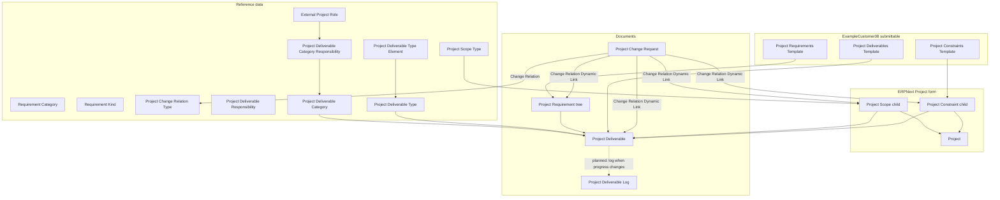

[Русский](README.ru.md)

# Dinext Project Scope

## 📖 Overview

**Dinext Project Scope** is a Frappe application for [ERPNext](https://erpnext.com/) that extends the standard **Project** with **scope**, **constraints and assumptions**, **requirements**, **project deliverables**, and **change requests**. The module combines reference data, ExampleCustomer08 (submittable), hierarchical requirements, and links to tasks, contacts, accounts and project roles.

All main application DocTypes belong to the **Dinext Project Scope** module and are supplied as JSON/Python in the repository; operation requires ERPNext and, for full linking functionality, other Dinext applications that already define **Project Role** and, where necessary, **Project Risk**.

## ✨ Features

- **Project scope**: the **Project Scope** child table on the ERPNext **Project** form (Scope tab) — scope type, description, and a Dynamic Link to an object (options from **Project Scope Type**).
- **Constraints and assumptions**: **Project Constraint** as a table in **Project** and **Project Constraints Template**.
- **Reference data**: **Project Scope Type**, **Requirement Category**, **Requirement Kind**, **Project Change Relation Type**, **Project Deliverable Responsibility**, **Project Deliverable Type** (+ **Project Deliverable Type Element** rows), **Project Deliverable Category** (+ **Project Deliverable Category Responsibility** linked to **Project Role**).
- **Requirements**: hierarchical **Project Requirement** (`is_tree`) with project, priority, level (Must/Should/Nice), status and category; **Project Requirement Item** child rows (when used in the form).
- **ExampleCustomer08 (submittable)**: **Project Constraints Template**, **Project Requirements Template** (+ **Project Requirement Template Item**), **Project Deliverables Template** (+ **Project Deliverable Template Item**).
- **Change request**: **Project Change Request** (submittable) with the **Change Relation** table — relation type (**Project Change Relation Type**), direction, impact level, explanation, estimate, UOM (read-only from the type), and Dynamic Link to the related object.
- **Project deliverable**: **Project Deliverable** with the **Deliverable Scope**, **Deliverable Requirement**, **Deliverable Constraint**, **Project Deliverable Structure**, **Project Deliverable Responsible**, **Project Deliverable Item** tables (when enabled in the form).
- **Progress log**: **Project Deliverable Log** (a separate document).
- **Fixtures**: `hooks.py` configures the export of reference data and customizations (**Custom Field**, **Client Script**, **Server Script**) — see **Configuration** below; JSON files are in `dinext_project_scope/fixtures/`.

## 🚀 Installation

A working [bench](https://github.com/frappe/bench) with **Frappe** and **ERPNext** installed is required.

```bash
cd /path/to/frappe-bench
bench get-app <repository-url> --branch develop
bench --site <site_name> install-app dinext_project_scope
bench --site <site_name> migrate
```

After installation, check:

- the **Dinext Project Scope** module in the module list;
- the **Project** custom fields for the `project_scopes` and `project_constraints` tables (if necessary, create them through Customize Form or import fixtures with `bench --site <site> import-fixtures` after adding records to the repository).

## 🛠️ Usage

1. **Project**: open a **Project** document → **Scope** tab — fill in **Project Scope** and **Constraints and Assumptions** (if the fields have been added to the form).
2. **Requirements**: the **Project Requirement** list, filtered by the **Project** field; use the tree for the hierarchy.
3. **Deliverables**: **Project Deliverable** — type, category, status, linked scope/requirements/constraints, structure and responsible parties.
4. **ExampleCustomer08**: create and **Submit** constraint, requirement or deliverable template documents; use your installation's business logic to copy rows into the project (extend server scripts or DocType methods if necessary).
5. **Changes**: **Project Change Request** — description, initiator, reason/justification; in the **Change Relations** table, specify the relation type (**Project Change Relation Type**), direction, impact strength and a link to the affected entity.

**Dependencies on other DocTypes**

- **Project Role** (typically the **dinext_projects** application): links from deliverable categories and responsibility rows.
- **Project Risk** (when available in the bench): may appear in change relation type settings (**Project Change Relation Type** → Link DocType).
- **Task**, **Account**, standard **UOM** — according to **Project Change Relation Type** and link field settings.

Make sure these applications are installed on the site if you use the corresponding fields.

## 📦 Technologies

| Component | Version / notes |
|-----------|-------------------|
| Python | >= 3.10 (`pyproject.toml`) |
| Frappe / ERPNext | As in your bench installation (`required_apps`: **erpnext**) |
| Package build | flit (through `[build-system]` in `pyproject.toml`) |
| Linting / formatting | Ruff, pre-commit (eslint, prettier, pyupgrade — see `.pre-commit-config.yaml`) |

## 🔧 Configuration

The `dinext_project_scope/hooks.py` file:

- **`required_apps = ["erpnext"]`** — ERPNext is a required dependency.
- **`fixtures`** — `bench export-fixtures` / `bench import-fixtures` synchronizes records of the following DocTypes on the site (in the specified order):
  - **Project Scope Type**
  - **Requirement Kind**
  - **Project Deliverable Responsibility**
  - **Project Deliverable Category**
  - **Project Change Relation Type**
  - **Project Deliverable Type**
  - **Custom Field** (`Dinext Project Scope` module)
  - **Client Script** (`Dinext Project Scope` module)
  - **Server Script** (`Dinext Project Scope` module)

The application module is defined in `dinext_project_scope/modules.txt` (one line: `Dinext Project Scope`).

The **`dinext_project_scope/fixtures/`** directory contains JSON for the types listed in `hooks.py` and additional files (for example, `requirement_category.json`) that can be added to the `fixtures` list in `hooks.py` for automatic import when necessary. The `project_change_impact_type.json` file in the directory refers to the **Project Change Impact Type** DocType (if that DocType is deployed on the site); the current application tree may not contain a separate DocType folder with that name — check the site's actual schema.

The application itself requires no environment variables; site settings are standard Frappe settings (`site_config.json`).

### Reference records in the repository (guide)

After `import-fixtures` (with an up-to-date `hooks.py`), the site will contain, among others:

- **Project Deliverable Type**: `Документ` (Document), `Работа` (Work), `Разработка` (Development), `Тестирование` (Testing), `Миграция данных` (Data Migration) — with **Project Deliverable Type Element** child rows; for rows of type **Project Deliverable**, the **Filter** field (`filter_type`, Data) specifies the base deliverable type name: **`Документ`** or **`Работа`** (the **Project Deliverable Type** record's `name`). See `fixtures/project_deliverable_type.json` for details.
- **Project Change Impact Type** (if the DocType is available and import is configured): entries such as **Сроки** (Deadlines), **Трудозатраты** (Work Effort), **Фин. результат** (Financial Result), **Качество** (Quality), **Объем** (Scope) — see `fixtures/project_change_impact_type.json` (UOM records must exist on the site, for example, the localized **День** (Day), **Час** (Hour), **Единица** (Unit)).

If **UOM** names differ between sites, edit the fixture or the records in Desk after import.

## ✅ Requirements

- **bench** with Frappe and **ERPNext**
- **Python** >= 3.10
- For full linking: applications containing the **Project Role** DocType (and **Project Risk** if necessary)
- **MariaDB** / a compatible DBMS (as required by Frappe)

## 🤝 Contributing

1. Fork the repository and create a branch from `develop`.
2. Install **pre-commit** and run `pre-commit install` in the application root.
3. Follow the code style (Ruff, ESLint, Prettier according to the repository configuration).
4. For DocType changes, use the standard Frappe cycle: update JSON/Python, then run `migrate` and tests.

## 📄 Documentation

- Code and field schemas: the `dinext_project_scope/dinext_project_scope/doctype/<doctype_name>/` directory.
- Details for agents and the development environment: `AGENTS.md` (in the application root).
- ERPNext metadata: [Frappe Framework Documentation](https://docs.frappe.io/), [ERPNext Projects](https://docs.erpnext.com/).

## 📝 Changelog

| Date / commit | Description |
|---------------|----------|
| `ab8a146` | docs: AGENTS.md, README and retrospective analysis skills |
| `c684a02` | feat: Initialize App (initial application structure) |

*For the current history, run `git log` in a clone of the repository.*

## 🗂️ Repository Structure

```
dinext_project_scope/
├── README.md                 # Project documentation
├── AGENTS.md                 # Context for development and agents
├── license.txt               # MIT license
├── pyproject.toml            # Package metadata, Ruff, bench dependencies
├── .pre-commit-config.yaml   # Code quality hooks
├── .gitignore
└── dinext_project_scope/
    ├── hooks.py              # Application entry point: required_apps, fixtures
    ├── modules.txt           # Frappe module name
    ├── patches.txt           # Scaffold for pre/post_model_sync sections (patches as needed)
    ├── fixtures/             # JSON for import-fixtures (align contents with hooks.py)
    │   ├── custom_field.json
    │   ├── client_script.json
    │   ├── server_script.json
    │   ├── project_scope_type.json
    │   ├── requirement_kind.json
    │   ├── requirement_category.json
    │   ├── project_deliverable_responsibility.json
    │   ├── project_deliverable_category.json
    │   ├── project_change_relation_type.json
    │   ├── project_deliverable_type.json
    │   └── project_change_impact_type.json
    └── dinext_project_scope/
        └── doctype/          # All DocTypes in the Dinext Project Scope module
            ├── change_relation/
            ├── deliverable_constraint/
            ├── deliverable_requirement/
            ├── deliverable_scope/
            ├── project_change_relation_type/
            ├── project_change_request/
            ├── project_change_request_item/
            ├── project_constraint/
            ├── project_constraints_template/
            ├── project_deliverable/
            ├── project_deliverable_category/
            ├── project_deliverable_category_responsibility/
            ├── project_deliverable_item/
            ├── project_deliverable_log/
            ├── project_deliverable_responsibility/
            ├── project_deliverable_responsible/
            ├── project_deliverable_structure/
            ├── project_deliverable_template_item/
            ├── project_deliverable_type/
            ├── project_deliverable_type_element/
            ├── project_deliverables_template/
            ├── project_requirement/
            ├── project_requirement_item/
            ├── project_requirement_template_item/
            ├── project_requirements_template/
            ├── project_scope/
            ├── project_scope_type/
            ├── requirement_category/
            └── requirement_kind/
```

Each DocType folder usually contains:

- `*.json` — DocType and field schema;
- `*.py` — the `Document` class and controllers;
- `*.js` — form/list client scripts (if any);
- `test_*.py` — unit tests (if added).

## 🔗 Flow Chart

A simplified diagram of entities and data flows follows (from reference data to the project and changes).



**Note:** calculation of the **Project Deliverable** **progress** field from the weighted **Project Deliverable Structure** and automatic **Project Deliverable Log** recording are not implemented in the current controller code (`ProjectDeliverable` is an empty `Document` subclass); this can be added in `project_deliverable.py` and related hooks as implementation proceeds.
