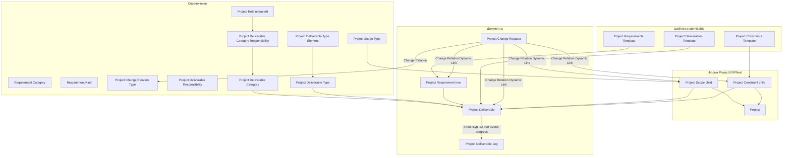

# Dinext Project Scope

## 📖 Overview

**Dinext Project Scope** — Frappe-приложение для [ERPNext](https://erpnext.com/), расширяющее стандартный **Project** управлением **объёмом работ**, **ограничениями и допущениями**, **требованиями**, **результатами проекта (deliverables)** и **запросами на изменение**. Модуль объединяет справочники, шаблоны (submittable), иерархические требования и связи с задачами, контактами, счетами и ролями проекта.

Все основные DocTypes приложения относятся к модулю **Dinext Project Scope** и поставляются в виде JSON/Python в репозитории; для работы нужны ERPNext и (для полной функциональности связей) другие приложения Dinext, где уже определены **Project Role** и при необходимости **Project Risk**.

## ✨ Features

- **Объём проекта**: дочерняя таблица **Project Scope** на форме ERPNext **Project** (вкладка «Объем») — тип объёма, описание, ссылка на объект через Dynamic Link (опции из **Project Scope Type**).
- **Ограничения и допущения**: **Project Constraint** как таблица в **Project** и в **Project Constraints Template**.
- **Справочники**: **Project Scope Type**, **Requirement Category**, **Requirement Kind**, **Project Change Relation Type**, **Project Deliverable Responsibility**, **Project Deliverable Type** (+ строки **Project Deliverable Type Element**), **Project Deliverable Category** (+ **Project Deliverable Category Responsibility** с привязкой к **Project Role**).
- **Требования**: иерархический **Project Requirement** (`is_tree`) с проектом, приоритетом, уровнем (Must/Should/Nice), статусом и категорией; дочерние строки **Project Requirement Item** (при использовании в форме).
- **Шаблоны (submittable)**: **Project Constraints Template**, **Project Requirements Template** (+ **Project Requirement Template Item**), **Project Deliverables Template** (+ **Project Deliverable Template Item**).
- **Запрос на изменение**: **Project Change Request** (submittable) с таблицей **Change Relation** — тип связи (**Project Change Relation Type**), направление, уровень влияния, пояснение, оценка, UOM (read-only с типа), Dynamic Link на связанный объект.
- **Результат проекта**: **Project Deliverable** с таблицами **Deliverable Scope**, **Deliverable Requirement**, **Deliverable Constraint**, **Project Deliverable Structure**, **Project Deliverable Responsible**, **Project Deliverable Item** (при включении в форму).
- **Журнал прогресса**: **Project Deliverable Log** (отдельный документ).
- **Фикстуры**: в `hooks.py` задан экспорт ряда справочников и кастомизаций (**Custom Field**, **Client Script**, **Server Script**) — см. раздел **Configuration** ниже; JSON-файлы лежат в `dinext_project_scope/fixtures/`.

## 🚀 Installation

Требуется рабочая [bench](https://github.com/frappe/bench) с установленным **Frappe** и **ERPNext**.

```bash
cd /path/to/frappe-bench
bench get-app <repository-url> --branch develop
bench --site <site_name> install-app dinext_project_scope
bench --site <site_name> migrate
```

После установки проверьте:

- модуль **Dinext Project Scope** в списке модулей;
- наличие пользовательских полей **Project** для таблиц `project_scopes` и `project_constraints` (при необходимости создайте через Customize Form или импортируйте фикстуры `bench --site <site> import-fixtures` после добавления записей в репозиторий).

## 🛠️ Usage

1. **Проект**: откройте документ **Project** → вкладка **«Объем»** — заполните **Объем проекта** и **Ограничения и допущения** (если поля добавлены в форму).
2. **Требования**: список **Project Requirement**, фильтрация по полю **Project**; используйте дерево для иерархии.
3. **Результаты**: **Project Deliverable** — тип, категория, статус, связанные объёмы/требования/ограничения, структура и ответственные.
4. **Шаблоны**: создайте и **Submit** документы шаблонов ограничений, требований или результатов; используйте бизнес-логику вашей установки для копирования строк в проект (при необходимости доработайте server scripts или методы DocType).
5. **Изменения**: **Project Change Request** — описание, инициатор, причина/обоснование; в таблице **Change Relations** указывайте тип связи (**Project Change Relation Type**), направление, силу влияния и ссылку на затронутую сущность.

**Зависимости от других DocTypes**

- **Project Role** (типично приложение **dinext_projects**): ссылки из категорий результатов и строк ответственности.
- **Project Risk** (при наличии в bench): может фигурировать в настройках типов связей изменений (**Project Change Relation Type** → Link DocType).
- **Task**, **Account**, стандартные **UOM** — по настройке **Project Change Relation Type** и полей связи.

Убедитесь, что эти приложения установлены на сайте, если используете соответствующие поля.

## 📦 Technologies

| Компонент | Версия / заметки |
|-----------|-------------------|
| Python | >= 3.10 (`pyproject.toml`) |
| Frappe / ERPNext | Как в установке bench (`required_apps`: **erpnext**) |
| Сборка пакета | flit (через `[build-system]` в `pyproject.toml`) |
| Линтинг / формат | Ruff, pre-commit (eslint, prettier, pyupgrade — см. `.pre-commit-config.yaml`) |

## 🔧 Configuration

Файл `dinext_project_scope/hooks.py`:

- **`required_apps = ["erpnext"]`** — обязательная зависимость от ERPNext.
- **`fixtures`** — при `bench export-fixtures` / `bench import-fixtures` на сайте синхронизируются записи следующих DocType (в указанном порядке):
  - **Project Scope Type**
  - **Requirement Kind**
  - **Project Deliverable Responsibility**
  - **Project Deliverable Category**
  - **Project Change Relation Type**
  - **Project Deliverable Type**
  - **Custom Field** (модуль `Dinext Project Scope`)
  - **Client Script** (модуль `Dinext Project Scope`)
  - **Server Script** (модуль `Dinext Project Scope`)

Модуль приложения задаётся в `dinext_project_scope/modules.txt` (одна строка: `Dinext Project Scope`).

Каталог **`dinext_project_scope/fixtures/`** содержит JSON для перечисленных в `hooks.py` типов и дополнительные файлы (например `requirement_category.json`), которые при необходимости можно добавить в список `fixtures` в `hooks.py` для автоматического импорта. Файл `project_change_impact_type.json` в каталоге относится к DocType **Project Change Impact Type** (если такой DocType развёрнут на сайте); в текущем дереве приложения отдельной папки DocType под это имя может не быть — сверяйте с фактической схемой сайта.

Переменные окружения для самого приложения не требуются; настройки сайта — стандартные Frappe (`site_config.json`).

### Справочные записи в репозитории (ориентир)

После `import-fixtures` (при актуальном `hooks.py`) на сайте появятся, в частности:

- **Project Deliverable Type**: `Документ`, `Работа`, `Разработка`, `Тестирование`, `Миграция данных` — с дочерними **Project Deliverable Type Element**; для строк с типом **Project Deliverable** поле **Filter** (`filter_type`, Data) задаёт имя базового типа результата: **`Документ`** или **`Работа`** (как `name` записи **Project Deliverable Type**). Подробнее — в `fixtures/project_deliverable_type.json`.
- **Project Change Impact Type** (если DocType доступен и импорт настроен): записи вроде **Сроки**, **Трудозатраты**, **Фин. результат**, **Качество**, **Объем** — см. `fixtures/project_change_impact_type.json` (UOM на сайте должны существовать, например локализованные **День**, **Час**, **Единица**).

При расхождении имён **UOM** между сайтами отредактируйте фикстуру или записи в Desk после импорта.

## ✅ Requirements

- **bench** с Frappe и **ERPNext**
- **Python** >= 3.10
- Для полных связей: приложения с DocType **Project Role** (и при необходимости **Project Risk**)
- **MariaDB** / совместимая СУБД (как у Frappe)

## 🤝 Contributing

1. Форкните репозиторий и создайте ветку от `develop`.
2. Установите **pre-commit** и выполните `pre-commit install` в корне приложения.
3. Соблюдайте стиль кода (Ruff, ESLint, Prettier по конфигурации репозитория).
4. Для DocType-доработок используйте стандартный цикл Frappe: изменение JSON/Python, затем `migrate` и тесты.

## 📄 Documentation

- Код и схемы полей: каталог `dinext_project_scope/dinext_project_scope/doctype/<doctype_name>/`.
- Подробности для агентов и среды разработки: `AGENTS.md` (в корне приложения).
- Метаданные ERPNext: [Frappe Framework Documentation](https://docs.frappe.io/), [ERPNext Projects](https://docs.erpnext.com/).

## ❤️ Acknowledgements

- [Frappe Technologies](https://frappe.io/) — Frappe Framework и ERPNext.
- Dinext — автор и сопровождение приложения.

## 📝 Changelog

| Дата / коммит | Описание |
|---------------|----------|
| `ab8a146` | docs: AGENTS.md, навыки README и ретроспективного анализа |
| `c684a02` | feat: Initialize App (начальная структура приложения) |

*Для актуальной истории выполните `git log` в клоне репозитория.*

## 🗂️ Repository Structure

```
dinext_project_scope/
├── README.md                 # Документация проекта
├── AGENTS.md                 # Контекст для разработки и агентов
├── license.txt               # Лицензия GPL-3
├── pyproject.toml            # Метаданные пакета, Ruff, зависимости bench
├── .pre-commit-config.yaml   # Хуки качества кода
├── .gitignore
└── dinext_project_scope/
    ├── hooks.py              # Точка входа приложения: required_apps, fixtures
    ├── modules.txt           # Имя модуля Frappe
    ├── patches.txt           # Заготовка секций pre/post_model_sync (патчи по мере необходимости)
    ├── fixtures/             # JSON для import-fixtures (состав согласовать с hooks.py)
    │   ├── custom_field.json
    │   ├── client_script.json
    │   ├── server_script.json
    │   ├── project_scope_type.json
    │   ├── requirement_kind.json
    │   ├── requirement_category.json
    │   ├── project_deliverable_responsibility.json
    │   ├── project_deliverable_category.json
    │   ├── project_change_relation_type.json
    │   ├── project_deliverable_type.json
    │   └── project_change_impact_type.json
    └── dinext_project_scope/
        └── doctype/          # Все DocTypes модуля Dinext Project Scope
            ├── change_relation/
            ├── deliverable_constraint/
            ├── deliverable_requirement/
            ├── deliverable_scope/
            ├── project_change_relation_type/
            ├── project_change_request/
            ├── project_change_request_item/
            ├── project_constraint/
            ├── project_constraints_template/
            ├── project_deliverable/
            ├── project_deliverable_category/
            ├── project_deliverable_category_responsibility/
            ├── project_deliverable_item/
            ├── project_deliverable_log/
            ├── project_deliverable_responsibility/
            ├── project_deliverable_responsible/
            ├── project_deliverable_structure/
            ├── project_deliverable_template_item/
            ├── project_deliverable_type/
            ├── project_deliverable_type_element/
            ├── project_deliverables_template/
            ├── project_requirement/
            ├── project_requirement_item/
            ├── project_requirement_template_item/
            ├── project_requirements_template/
            ├── project_scope/
            ├── project_scope_type/
            ├── requirement_category/
            └── requirement_kind/
```

Каждая папка DocType обычно содержит:

- `*.json` — схема DocType и полей;
- `*.py` — класс `Document` и контроллеры;
- `*.js` — клиентские скрипты формы/списка (если есть);
- `test_*.py` — unit-тесты (если добавлены).

## 🔗 Flow Chart

Ниже упрощённая схема сущностей и потоков данных (от справочников к проекту и изменениям).



**Примечание:** расчёт поля **progress** у **Project Deliverable** по взвешенной структуре (**Project Deliverable Structure**) и автозапись **Project Deliverable Log** в текущем коде контроллера не реализованы (`ProjectDeliverable` — пустой наследник `Document`); это может быть добавлено в `project_deliverable.py` и связанных хуках по мере внедрения.
