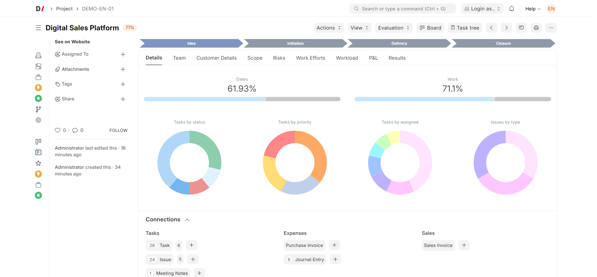
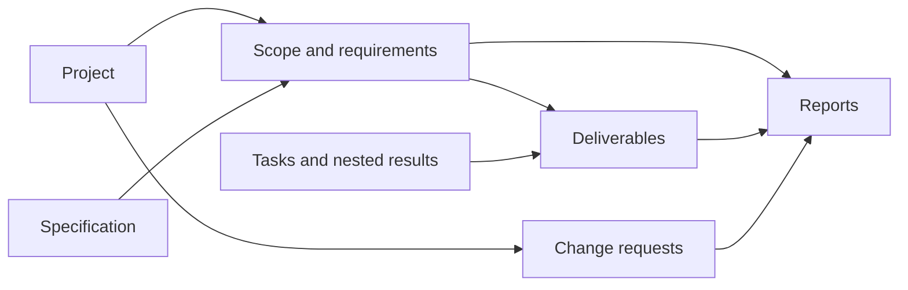

[Русский](README.ru.md)

<!-- dinext-presentation:start -->
<p align="center">
  <a href="https://dinext.ru"></a>
</p>
<h1 align="center">Dinext Project Scope</h1>

<hr>

<p align="center">Manage project scope, requirements, constraints, deliverables and change requests in Dinext.</p>

<p align="center">
  
</p>
<p align="center"><sub>The shared Dinext project workspace, including its Scope and Results sections (demonstration project).</sub></p>

<p align="center">
  <a href="https://dinext.ru">Website</a> · <a href="https://docs.dinext.ru">Documentation</a>
</p>
<!-- dinext-presentation:end -->

# Dinext Project Scope

## 📖 Overview

Dinext Project Scope adds scope, requirements, constraints, deliverables and change requests to the ERPNext Project form. It uses Dinext Workflow for approvals and records the submitted content so that later revisions can be traced to the right decision.

## ✨ Features

- One requirements tree on each project, specification and specification template. A requirement appears once even when it belongs to several branches of the same specification.
- Separate reusable specification templates. Applying a template creates working specifications and requirements owned by the selected project.
- Explicit checks and supporting evidence for assumptions. Project constraints and assumptions can be created from a template.
- Deliverable structures built from types. Linked tasks and nested results determine weighted progress and separate planned, forecast and actual dates. Project participants can be assigned responsibilities as users or contacts.
- Change requests with an impact estimate, approval history and links to the documents changed during implementation.
- Traceability, responsibility and change impact matrices. The responsibility and impact matrices can be exported to Excel. The overview and registers help teams find the details behind the totals and charts.

## 🚀 Installation

In a Frappe and ERPNext 15 bench with Dinext Common, Dinext Projects and Dinext Goals installed on the site, install the app from the approved branch or release. Set `<ref>` and `<site>` for your environment.

```bash
bench get-app --branch <ref> https://github.com/Dinext-pro/dinext-project-scope.git
bench --site <site> install-app dinext_project_scope
bench --site <site> migrate
bench build --app dinext_project_scope
bench --site <site> clear-cache
```

## 🛠️ Usage

1. Open **Project → Scope**. Add requirements directly, connect a specification, or preview a template and create a project-specific set. Open a row to work on the requirement or expand its details to see the inclusion paths.
2. Open the relevant specification or template record to manage its direct contents and submit the full set for review. Editing approved content makes the previous decision historical and opens the need for a new approval.
3. Use **Project → Deliverables** to create results, assign responsibility, link work and request acceptance. Open the project scope reports from the project or find them through Desk search.
4. Create a change request from the project and add its impact details. After approval, the implementation owner records the date, explanation and changed documents, then marks the request implemented.

## 🔧 Configuration

Assign the project manager role to one active user on the project team. Set the role in **Project Scope Settings** if your team uses a different role name. The supplied workflows use that assignment for deliverable acceptance and change decisions. The default requirement and specification workflows route review to the assigned responsible user. Configure alternative routes through the standard Dinext Workflow tools. Enable the existing parallel approval engine on the site for these routes.

## 📦 Technologies and requirements

Frappe and ERPNext 15, Python, JavaScript, MariaDB, Dinext Workflow, DinextTable and DinextCharts. Dinext Projects supplies project roles and participants. Dinext Goals supplies the goals that requirements can reference.

## Repository structure

- `dinext_project_scope/dinext_project_scope/doctype` contains project documents and reference data.
- `dinext_project_scope/dinext_project_scope/report` contains the registered Desk reports.
- `dinext_project_scope/analytics`, `public`, `setup` and `translations` contain server selections, interface assets, installation defaults and translations.
- The app's Python test modules and `cypress/integration` cover document behavior and Desk flows.



## 🤝 Contributing and verification

Run the checks on an isolated test site with Dinext Workflow enabled and the developer server running. Open a pull request to `develop` with the test results.

```bash
bench --site <test-site> run-tests --app dinext_project_scope --skip-test-records
bench --site <test-site> run-ui-tests dinext_project_scope --headless
```

## 📄 Documentation

See the [Dinext documentation](https://docs.dinext.ru/) for the project workspace and standard Workflow settings.

## License

[GNU General Public License v3.0](license.txt).
