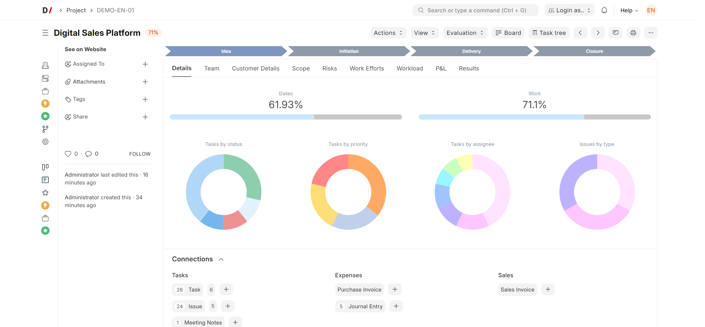
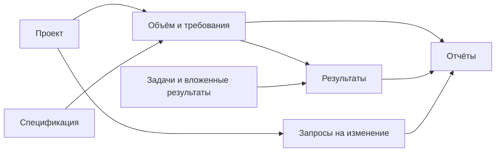

[English](README.md)

<!-- dinext-presentation:start -->
<p align="center">
  <a href="https://dinext.ru"></a>
</p>
<h1 align="center">Dinext Project Scope</h1>

<hr>

<p align="center">Управление содержанием проекта, требованиями, ограничениями, результатами и запросами на изменения в Dinext.</p>

<p align="center">
  
</p>
<p align="center"><sub>Общая карточка проекта Dinext с разделами Scope и Results на примере учебного проекта.</sub></p>

<p align="center">
  <a href="https://dinext.ru">Сайт</a> · <a href="https://docs.dinext.ru">Документация</a>
</p>
<!-- dinext-presentation:end -->

# Dinext Project Scope

## 📖 Обзор

Dinext Project Scope добавляет в карточку проекта ERPNext управление объёмом, требованиями, ограничениями, результатами и запросами на изменение. Маршруты согласования работают через Workflow Dinext. Модуль сохраняет содержание на момент подачи, чтобы связать каждую согласованную редакцию с решением.

## ✨ Возможности

- Одно дерево требований в каждой карточке проекта, спецификации и шаблона. Требование занимает одну строку, даже если входит в несколько ветвей спецификации.
- Отдельные шаблоны спецификаций. Применение шаблона создаёт рабочие спецификации и требования выбранного проекта.
- Проверка допущений с пояснением и подтверждающими вложениями. Ограничения и допущения можно создавать из шаблона.
- Структура результата по его типу. Взвешенный прогресс, плановые, ожидаемые и фактические даты рассчитываются по задачам и вложенным результатам. Ответственность можно назначить пользователям и контактам проекта.
- Запросы на изменение с оценкой влияния, историей согласований и ссылками на изменённые документы.
- Матрицы прослеживаемости, ответственности и влияния изменений. Матрицы ответственности и влияния выгружаются в Excel. Обзор и реестры позволяют перейти от показателя или графика к документам.

## 🚀 Установка

В bench с Frappe и ERPNext 15, где на сайте установлены Dinext Common, Dinext Projects и Dinext Goals, установите приложение из принятой ветки или выпуска. Подставьте `<ref>` и `<site>` для своей среды.

```bash
bench get-app --branch <ref> https://github.com/Dinext-pro/dinext-project-scope.git
bench --site <site> install-app dinext_project_scope
bench --site <site> migrate
bench build --app dinext_project_scope
bench --site <site> clear-cache
```

## 🛠️ Работа с модулем

1. Откройте **Проект → Объём**. Добавьте требования напрямую, подключите спецификацию или проверьте состав в предпросмотре и создайте отдельный набор для проекта. Откройте требование из строки или раскройте подробности, чтобы увидеть пути включения.
2. В карточке спецификации или шаблона управляйте прямым составом и подавайте весь набор на согласование. При правке согласованного содержания система сохраняет прежнее решение в истории, а для новой редакции требуется повторное согласование.
3. На вкладке **Проект → Результаты** создавайте результаты, назначайте ответственность, связывайте работы и подавайте результат на приёмку. Матрицы доступны из проекта и через поиск Desk.
4. Создайте запрос на изменение из проекта и добавьте оценку влияния. После одобрения ответственный записывает дату, пояснение и изменённые документы, затем подтверждает выполнение запроса.

## 🔧 Настройка

Назначьте одного действующего пользователя на роль руководителя в команде проекта. Если команда использует другое название роли, выберите её в **Настройках объёма проекта**. В начальных маршрутах этот пользователь принимает результаты и решения по запросам. Требования и спецификации согласовывает назначенный ответственный. Другие маршруты настраиваются в Workflow Dinext. Для этих маршрутов на сайте используется штатный механизм параллельного согласования.

## 📦 Технологии и требования

Frappe и ERPNext 15, Python, JavaScript, MariaDB, Workflow Dinext, DinextTable и DinextCharts. Роли и участников проекта предоставляет Dinext Projects. Связанные с требованиями цели ведутся в Dinext Goals.

## Структура репозитория

- `dinext_project_scope/dinext_project_scope/doctype` содержит проектные документы и справочники.
- `dinext_project_scope/dinext_project_scope/report` содержит отчёты Desk.
- `dinext_project_scope/analytics`, `public`, `setup` и `translations` содержат серверные выборки, интерфейс, настройки установки и переводы.
- Серверные тесты в приложении и `cypress/integration` проверяют документы и сценарии Desk.



## 🤝 Участие в разработке и проверки

Запускайте проверки на отдельном тестовом сайте с включённым Workflow Dinext и работающим сервером разработки. Откройте pull request в `develop` и приложите результаты проверок.

```bash
bench --site <test-site> run-tests --app dinext_project_scope --skip-test-records
bench --site <test-site> run-ui-tests dinext_project_scope --headless
```

## 📄 Документация

Описание проектной карточки и настройки маршрутов доступны в [документации Dinext](https://docs.dinext.ru/).

## Лицензия

[GNU General Public License v3.0](license.txt).
